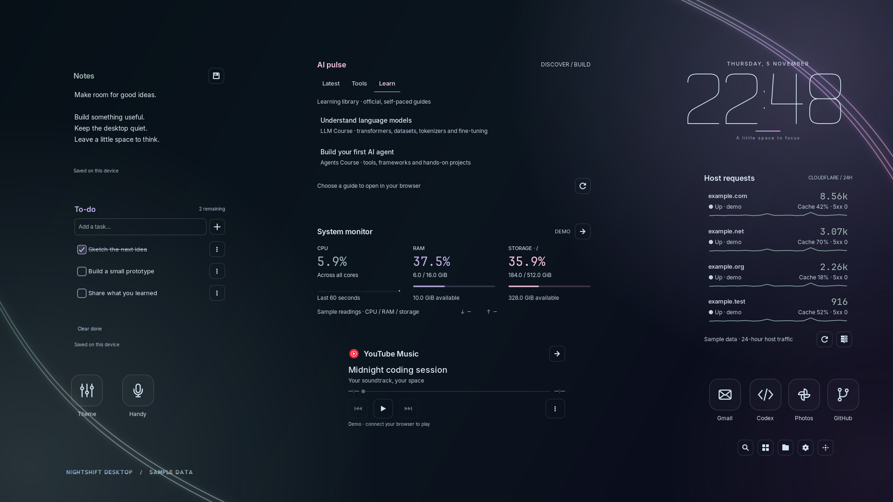

# Nightshift Desktop

A quiet, transparent desktop with a monoline clock, useful widgets, and an RGB palette you can make your own.

Built on **Zorin OS 18.1 · GNOME 46 · X11**. Native GTK widgets, a static generated wallpaper, and coordinated GTK, Shell, terminal, and optional editor colors.



*The preview renders the real widgets with sample notes, example domains, and synthetic readings. No personal accounts or desktop contents are included. It illustrates the optional full layout; a fresh install starts with fewer widgets.*

## What’s inside

| Component | What it does |
| --- | --- |
| RGB Studio | Primary, secondary, and highlight colors; darkness and glow controls; presets; preview; one-step Undo |
| Desktop | Transparent GTK/Shell surfaces, quick settings and notification styling, bottom dock configuration, original 4K wallpaper generator |
| Clock | Scalable single-stroke numerals, calendar, and focus timer |
| Layouts | Move and resize widgets with pointer or keyboard; saved Coding, Focus, and Chill layouts |
| Notes & tasks | Local autosaved notes, to-do items, completion and undo |
| System monitor | CPU, RAM, disk, and network activity with bounded sampling |
| AI pulse | Hugging Face posts, recent AI repositories, and a curated learning tab |
| Site insights | Optional Cloudflare host analytics and separate HTTPS health checks for up to four sites |
| Shortcuts | Gmail, Google Photos, GitHub activity, local Codex sessions, Handy, and RGB Studio |
| Music | YouTube Music shortcut, last played track, browser media controls, and seeking when supported |
| Productivity | Project/app/session launcher, Git status, optional named workspace shortcuts |
| Terminal | Coordinated GNOME Terminal colors, a small startup card, and a launcher that avoids stale D-Bus routing |

This is a desktop customization project, not a distribution or window manager. The widget host currently requires **X11**. Other GNOME versions, Wayland, KDE, and Hyprland are not verified targets.

## Install

Use the system Python so PyGObject can find the distribution’s GTK bindings. On Ubuntu/Zorin:

```sh
sudo apt install git curl python3-gi python3-gi-cairo python3-cairo \
  gir1.2-gtk-3.0 gnome-terminal x11-utils wmctrl papirus-icon-theme \
  fonts-inter fonts-jetbrains-mono

git clone https://github.com/Shaktiprasadram22/nightshift-desktop.git
cd nightshift-desktop

# Inspect the planned files and settings first.
/usr/bin/python3 install.py install --desktop --autostart --dry-run

# Install the widgets and apply the desktop appearance.
/usr/bin/python3 install.py install --desktop --autostart
~/.local/bin/nightshift-home
```

The installer is per-user and does not require sudo. It does not download code, install extensions, enable GNOME’s extension master switch, replace your shell configuration, or change **Super+D / Super+Arrow** bindings. Omit `--desktop` to install only the widget application; omit `--autostart` to start it manually.

Shell styling requires a compatible **User Themes** extension that you have enabled. The bottom dock settings apply when **Dash to Dock** is installed. Blur needs a compatible **Blur my Shell** extension; it is not a CSS feature. See [desktop compatibility and finishing touches](docs/DESKTOP.md). Log out and back in if GNOME does not reload the Shell theme.

Open **Nightshift Home** from the application drawer to choose widgets. Use **Arrange desktop** to move/resize them and **RGB Studio** to change the palette. The `Aurora glass` preset matches the preview; `Midnight cyan`, `Cyber violet`, `Aurora mint`, `Ember`, and `Arctic` are also included.

### Optional editor matching

Editor matching is off by default. Install Node.js/npm, then install the pinned JSONC parser in the installed application:

```sh
npm ci --ignore-scripts --prefix ~/.local/share/nightshift-home
```

Enable editor matching in RGB Studio to coordinate existing VS Code/Cursor profiles. Only appearance keys are merged; JSONC comments and unrelated settings are preserved.

### Connect your own services

No accounts are preconfigured. Cloudflare, Gmail, Photos, GitHub, AI pulse, Handy, and Codex panels start disabled. Enable the ones you use in Home settings.

Read [integration setup](docs/INTEGRATIONS.md) for Cloudflare OAuth and host configuration, Google accounts, selected Google Photos, GitHub CLI authentication, browser media controls, and local session shortcuts. You do not need any of these services to use the clock, theme, notes, tasks, or system monitor.

## Restore or uninstall

RGB Studio’s **Undo** reverses its most recent successful palette application. Before uninstalling, quit the widgets and undo recent palette changes if you want the installer’s original appearance back:

```sh
~/.local/bin/nightshift-home --quit
/usr/bin/python3 install.py uninstall
```

The installer keeps a private journal at `~/.local/state/nightshift-desktop/install.json`. Uninstall restores files/settings that still match its last installation. Later edits are preserved and listed for manual review; it does not forcibly overwrite them. Notes, tasks, selected photos, caches, credentials, and other user-created data are retained. Keep the checkout and journal until you are satisfied with restoration.

Re-running installation preserves an existing widget configuration and layout. It also keeps installed files you have edited. To take an upstream update for a modified file, compare it with the new source and merge it explicitly.

## Development

```sh
npm ci --ignore-scripts --prefix src/nightshift_home
/usr/bin/python3 tools/test.py
```

Tests use a temporary `NIGHTSHIFT_HOME` and an in-memory settings backend. They cover data parsing, layout geometry, stores, media controls, theme transactions, portable installation, and rollback without connecting accounts or changing your desktop.

To regenerate the preview using actual GTK widgets and synthetic data:

```sh
# Requires an X display. In CI, install xvfb and prefix with xvfb-run -a.
dbus-run-session -- /usr/bin/python3 tools/render_demo.py
```

See [CONTRIBUTING.md](CONTRIBUTING.md) for the source map and validation guidelines, and [SECURITY.md](SECURITY.md) for local-data handling.

## License and credits

Distributed under **GNU GPL v3**. The GTK/Shell theme is a customized derivative of [Orchis](https://github.com/vinceliuice/Orchis-theme), itself based on [Materia](https://github.com/nana-4/materia-theme). Folder assets derive from [Papirus](https://github.com/PapirusDevelopmentTeam/papirus-icon-theme). Upstream license copies and attribution are included in [THIRD_PARTY_NOTICES.md](THIRD_PARTY_NOTICES.md) and [LICENSES](LICENSES).

Nightshift’s widget code, monoline drawings, palette tools, and wallpaper generators are included as editable source. Fonts and external applications are not bundled. Product names belong to their respective owners; this project is not affiliated with those services.
